<div align="center">

# BulSU Library Management System

**A desktop library system for Bulacan State University: members, a three-kind catalog, lending and returns, and one sign-in for librarians and administrators.**
Built with Java 21 · Swing · FlatLaf · JDBC · MySQL **or** Microsoft SQL Server.

[](https://github.com/OWNER/bulsu-library-management-system/actions/workflows/ci.yml)


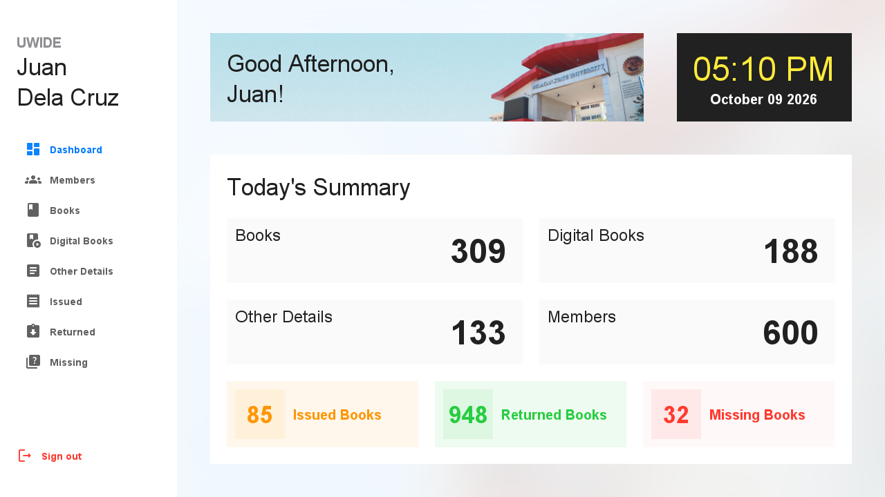

</div>

> **For teachers and students.** This repository is a *reference implementation*: every line is written to be read.
> It shows a layered architecture, object-oriented design (abstract classes, interfaces, polymorphism, encapsulation),
> parameterised JDBC with transactions, password hashing, and an automated test suite that drives the real GUI against a real database.
> [`docs/RUBRIC.md`](docs/RUBRIC.md) maps each grading criterion to the exact files that demonstrate it.

---

## Contents

[Features](#features) · [Screenshots](#screenshots) · [Quick start](#quick-start) · [Configure the connection](#configure-the-connection) · [Using the app](#using-the-app) · [Project structure](#project-structure) · [Architecture](#architecture-in-two-minutes) · [Testing](#testing) · [Data privacy](#data-privacy) · [Security](#security-notes) · [Troubleshooting](#troubleshooting) · [Documentation](#documentation) · [Contributing](#contributing) · [License](#license)

## Features

| Area | What you can do |
|---|---|
| **One sign-in** | Librarians and the administrator use the *same* screen; the account's role opens the right dashboard. Three wrong passwords lock a librarian until an administrator unlocks them; three failures in a row pause sign-in for 15 seconds. |
| **Members** | Browse students, add one through a five-step wizard (with duplicate check and a review step), view details, remove members who have no borrowing history. |
| **Catalog** | Three kinds of entries, each behaving differently: **Books** (one copy, lent once at a time), **Digital Books** (always available, many borrowers), **Other Details** (journals, magazines, theses: reference only). |
| **Lending** | Borrow and return with automatic due dates. *Issued*, *Returned* and *Missing* (overdue) lists. A book can never be lent to two people at once, even if two librarians click at the same moment. |
| **Dashboard** | Time-of-day greeting, live clock and today's numbers. |
| **Administration** | Add, edit, unlock and remove librarian accounts. Removing asks you to type the librarian's username. |
| **Two databases** | The same code runs on **MySQL 8** or **SQL Server**; only the connection URL changes. |
| **Realistic demo data** | 600 members, 630 catalog entries, 1,000+ loans, 30 staff accounts, all **synthetic** (see [Data privacy](#data-privacy)). |

## Screenshots

All pictures are generated by the project itself (`ScreenshotsIT` drives the real application against the seeded database), so they never go stale.

| | |
|---|---|
| <br>**One sign-in** for every role | 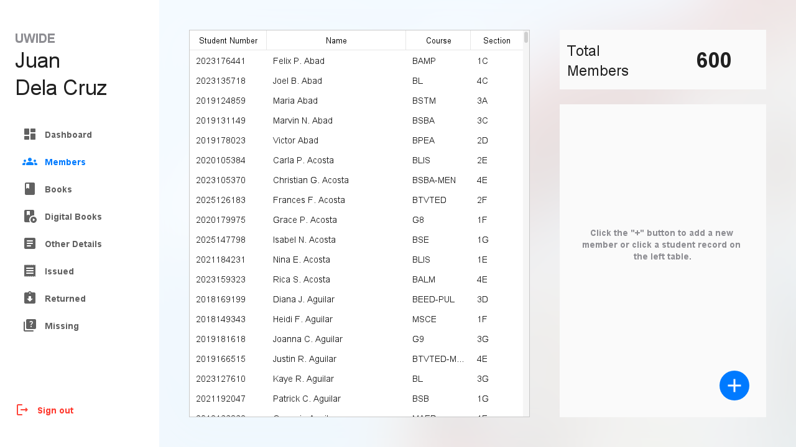<br>**Members** |
| 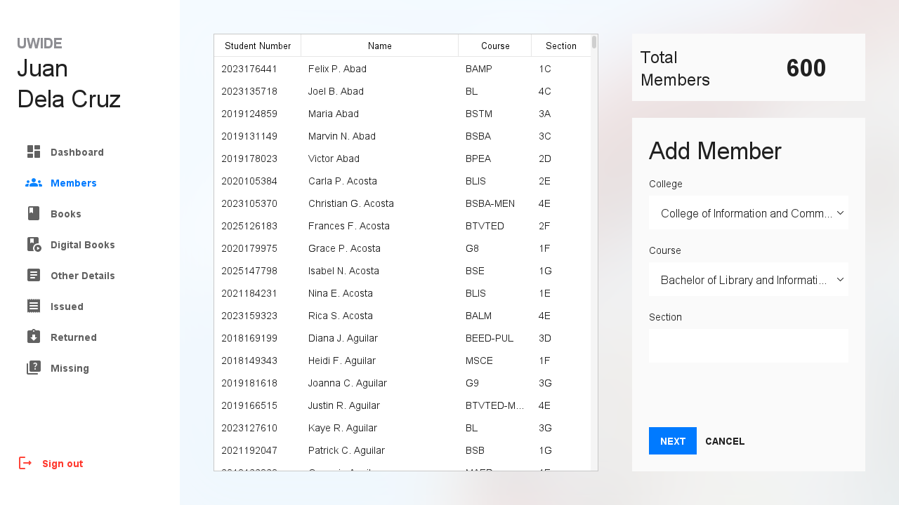<br>**Wizard**: the course list follows the chosen college | 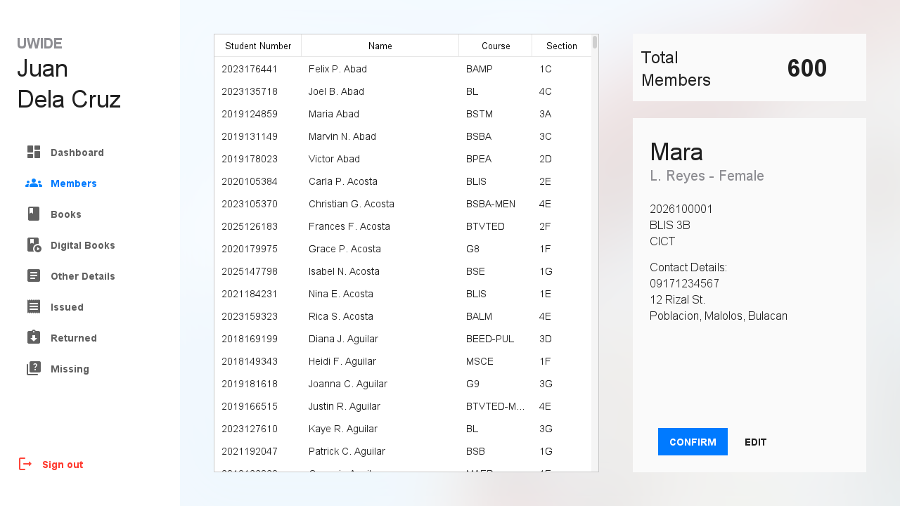<br>**Review** before saving |
| 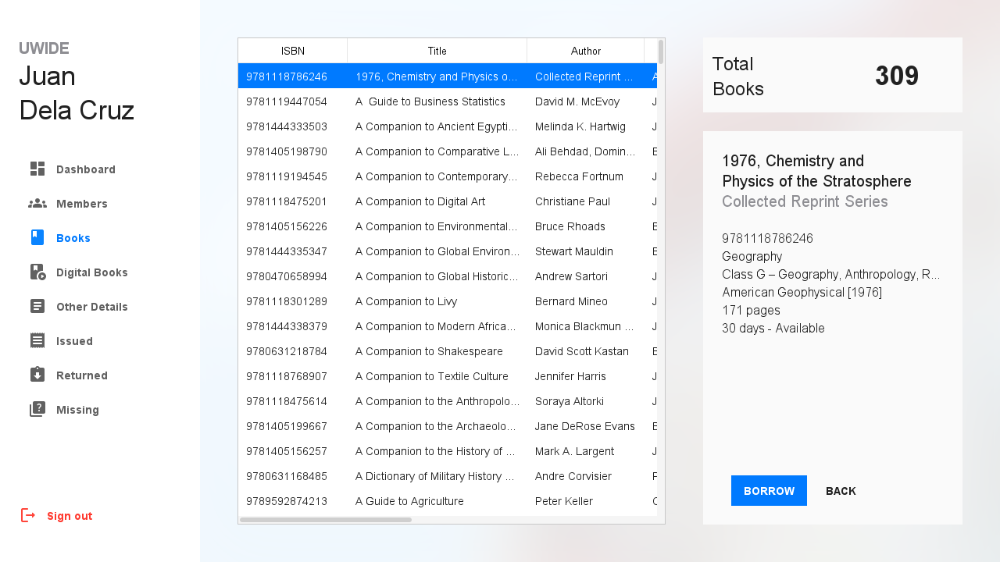<br>**Book details**, with BORROW | 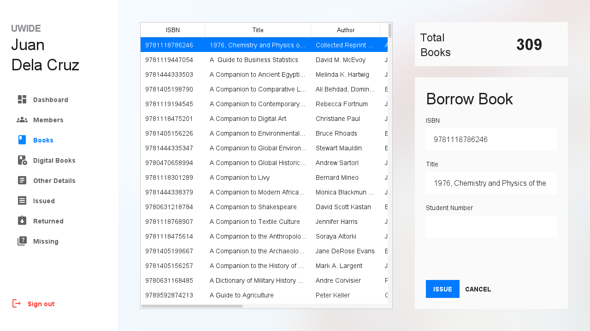<br>**Borrow** a book for a member |
| 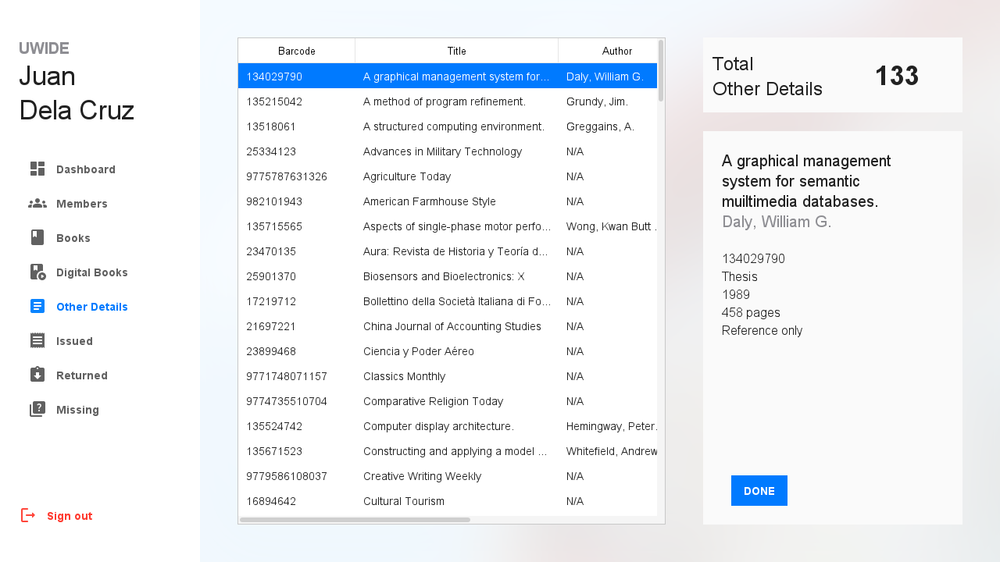<br>**Reference material** has no BORROW, only DONE | 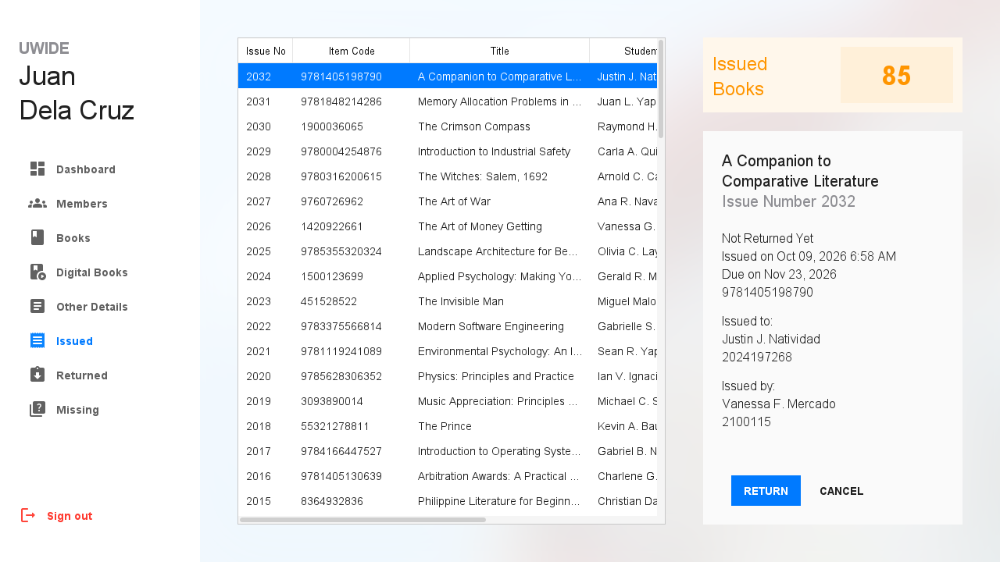<br>**Issued** loans, with RETURN |
| 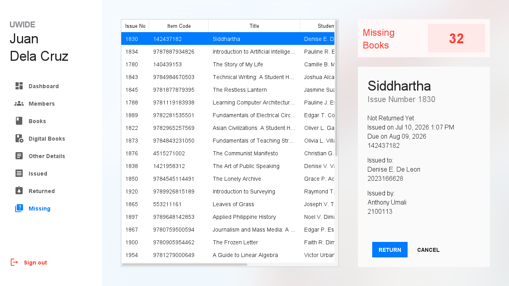<br>**Missing**: past the due date | 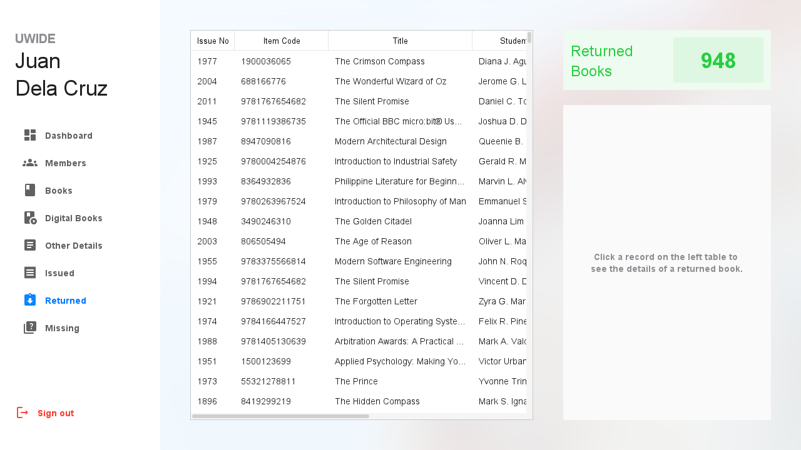<br>**Returned** history |
| 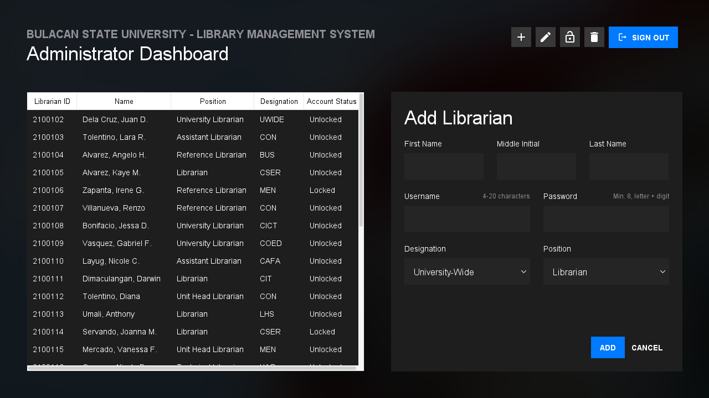<br>**Administrator** dashboard (dark) | 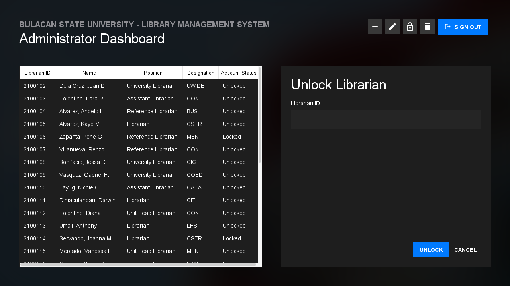<br>**Unlock** a locked librarian |

<details>
<summary><b>More screenshots</b> (dialogs, other screens)</summary>

| | |
|---|---|
| 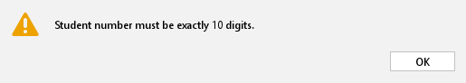<br>Validation message | <br>Confirmation before discarding input |
| 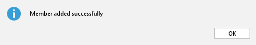<br>Success message | 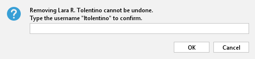<br>Type-to-confirm before a removal |
| 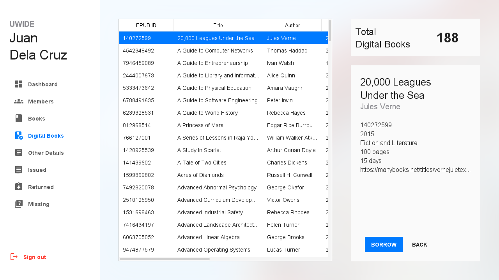<br>Digital book | 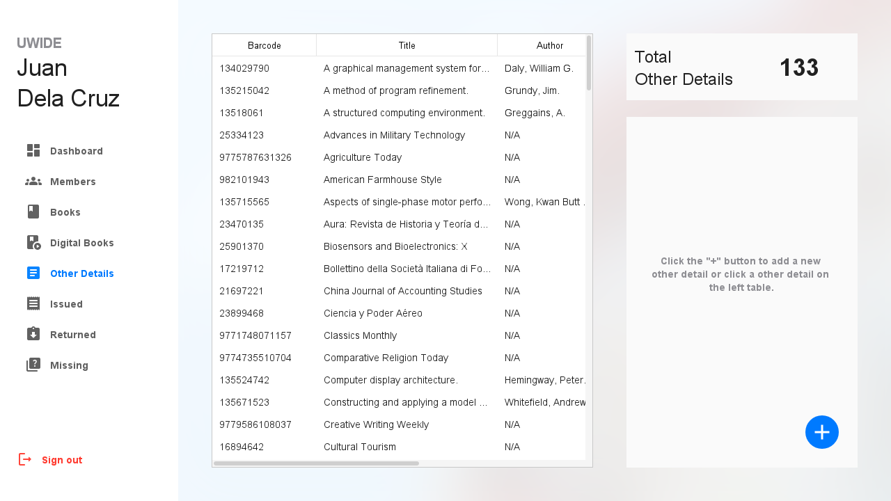<br>Other details list |
| 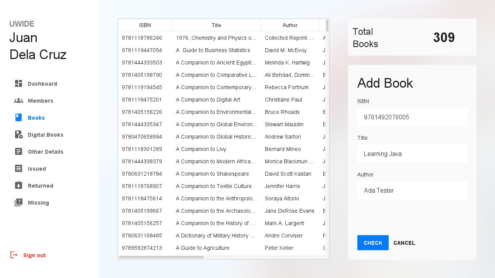<br>Add-book wizard | 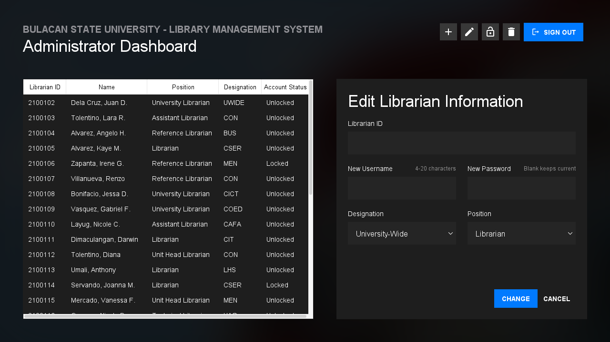<br>Edit librarian |

</details>

## Quick start

### 1. Prerequisites

* **JDK 21 or newer** (`java -version`). Nothing else to install for the build: the Maven wrapper (`mvnw`) downloads Maven for you.
* **A database**: MySQL 8.0.16+ **or** SQL Server 2019+ (Express is fine). You do not need both.

### 2. Get the code

```bash
git clone https://github.com/OWNER/bulsu-library-management-system.git
cd bulsu-library-management-system
```

### 3. Create the database

<details open>
<summary><b>MySQL</b></summary>

Edit `db/mysql/00_create_database.sql` and replace `YOUR_STRONG_PASSWORD` with a password of your own (the app refuses to start if you leave a placeholder in `lms.properties`), then:

```bash
mysql -u root -p < db/mysql/00_create_database.sql        # database + a least-privilege app user
mysql -u root -p bulsu_lms < db/mysql/01_schema.sql       # tables
mysql -u root -p bulsu_lms < db/mysql/02_seed.sql         # demo data (optional but recommended)
```
</details>

<details>
<summary><b>Microsoft SQL Server</b></summary>

Edit `db/mssql/00_create_database.sql` and replace `YOUR_Strong_Password_1!` with a password of your own (SSMS works too), then:

```bash
sqlcmd -S localhost -U sa -P <admin-password> -f 65001 -i db/mssql/00_create_database.sql
sqlcmd -S localhost -U sa -P <admin-password> -f 65001 -d bulsu_lms -i db/mssql/01_schema.sql
sqlcmd -S localhost -U sa -P <admin-password> -f 65001 -d bulsu_lms -i db/mssql/02_seed.sql
```
`-f 65001` makes `sqlcmd` read the scripts as UTF-8 (names such as *Mañgalile* must survive).
</details>

### 4. Tell the app how to connect

```bash
cp lms.properties.example lms.properties      # Windows: copy lms.properties.example lms.properties
```

Open `lms.properties` and set the URL, user and password. See [Configure the connection](#configure-the-connection).

### 5. Build and run

```bash
./mvnw package                 # Windows: mvnw.cmd package   (runs the fast unit tests too)
java -jar target/bulsu-lms.jar
```

### 6. Sign in

| Role | Username | Password | Lands on |
|---|---|---|---|
| Administrator | `admin` | `Admin@2026` | Administrator dashboard |
| Librarian | `librarian` | `Library@2026` | Librarian workspace |

Every seeded librarian uses `Library@2026`. Two seeded librarians are **locked** so you can try *Unlock* in the administrator dashboard.
These are demo credentials stored as PBKDF2 hashes in the seed file: change them before using the system for real.

## Configure the connection

Each setting is read from, in order: **environment variable** → **`lms.properties`** → built-in default.

| Setting | Environment variable | `lms.properties` key | Default |
|---|---|---|---|
| JDBC URL | `LMS_DB_URL` | `lms.db.url` | `jdbc:mysql://localhost:3306/bulsu_lms` |
| User | `LMS_DB_USER` | `lms.db.user` | `bulsu_lms` |
| Password | `LMS_DB_PASSWORD` | `lms.db.password` | *(empty)* |

`lms.properties` is searched in the working directory, then in `~/.bulsu-lms/`, or wherever `-Dlms.config=<path>` points. It is listed in `.gitignore`: **never commit a real password.**

```properties
# MySQL
lms.db.url=jdbc:mysql://localhost:3306/bulsu_lms
# SQL Server
# lms.db.url=jdbc:sqlserver://localhost:1433;databaseName=bulsu_lms;encrypt=true;trustServerCertificate=true
lms.db.user=bulsu_lms
lms.db.password=the-password-you-chose
```

Switching vendors is only this URL: both JDBC drivers ship inside the jar and the SQL is portable (dates are passed from Java, never `NOW()` / `GETDATE()`).

> `trustServerCertificate=true` accepts any certificate. Use it **only** for a database on your own PC. For a remote database use a real certificate and drop it (see `lms.properties.example`).

## Using the app

* **Librarian workspace**, left sidebar: *Dashboard · Members · Books · Digital Books · Other Details · Issued · Returned · Missing*. Click a table row for details. The round **+** button starts an "add" wizard; **CANCEL** asks first if you typed something.
* **Lend a book**: Books → click the book → **BORROW** → type the member's 10-digit student number → **ISSUE**. Return it from **Issued** (or **Missing** when overdue) → click the loan → **RETURN**.
* **Administrator dashboard**: the toolbar buttons (+ ✎ 🔓 🗑) open the Add / Edit / Unlock / Remove form. Clicking a row fills in the Librarian ID for you.

## Project structure

```
bulsu-library-management-system/
├─ pom.xml, mvnw, mvnw.cmd          Maven build + wrapper (no Maven install needed)
├─ lms.properties.example           copy to lms.properties and edit
├─ db/
│  ├─ mysql/   00_create_database · 01_schema · 02_seed · 99_reset
│  ├─ mssql/   (same four scripts, SQL Server dialect)
│  ├─ seed-data/                    real catalog + college/course lists (CSV)
│  └─ tools/SeedGenerator.java      generates both seed scripts (synthetic people)
├─ src/main/java/edu/bulsu/lms/
│  ├─ App.java                      entry point
│  ├─ config/        AppConfig                    where settings come from
│  ├─ domain/        Person ► Student, Staff      the object model (validation lives here)
│  │                 LibraryItem ► PrintedBook, DigitalBook, OtherMaterial
│  │                 Loan, Role, Address, ...
│  ├─ persistence/   Database + one repository per table (JDBC, prepared statements)
│  ├─ security/      PasswordHasher (PBKDF2), PasswordPolicy
│  ├─ service/       AuthService, CirculationService, ... (business rules, transactions)
│  └─ ui/            kit/ reusable Swing parts · librarian/ · admin/ · LoginPanel, AppShell
├─ src/main/resources/images/       icons and pictures
├─ src/test/java/                   unit tests, DB integration tests, GUI end-to-end tests
├─ docs/                            architecture, database, rubric, testing, migration, UML, screenshots
└─ .github/                         CI workflow, issue and pull-request templates
```

## Architecture in two minutes

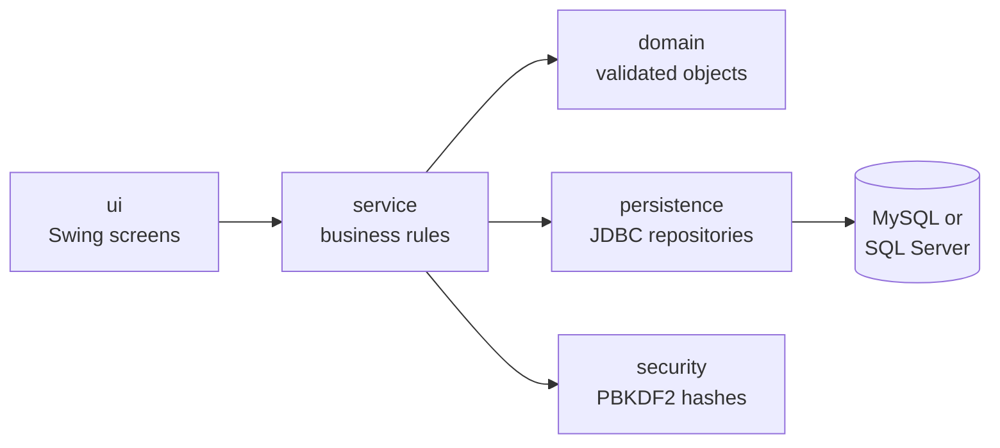

* **`domain`** knows nothing about Swing or SQL. Setters validate, so an invalid `Student` cannot exist.
* **`persistence`** turns rows into domain objects with parameterised statements. `Database` is the only class that opens (and always closes) connections; multi-statement work runs in a transaction.
* **`service`** enforces library rules ("a book already out cannot be lent"), makes lending atomic, and throws *user-facing* exceptions whose messages the UI shows verbatim.
* **`ui`** never touches SQL. Database calls run off the event thread (`Tasks`), so the window never freezes.

Read [`docs/ARCHITECTURE.md`](docs/ARCHITECTURE.md) for the design decisions, request flows and "how do I add a new item type?".

## Testing

```bash
./mvnw test        # ~65 unit tests, no database needed, runs in seconds
./mvnw verify      # + ~80 integration and GUI end-to-end tests (needs a database, see below)
```

The integration tests rebuild an empty database from the project's own SQL scripts, so they test the scripts too. Point them at a **throw-away** database (the first test drops every table):

```bash
export LMS_TEST_DB_URL="jdbc:mysql://127.0.0.1:3306/bulsu_lms_test"   # the name must end in _test
export LMS_TEST_DB_USER=... LMS_TEST_DB_PASSWORD=...
./mvnw verify
```
The tests refuse to run against a database whose name does not end in `_test`, so they cannot wipe your real library by accident.

Without `LMS_TEST_DB_URL` the integration tests are skipped, not failed. The GUI tests click real buttons in real components (no window needed, so they also run on CI) and check the database afterwards. GitHub Actions runs everything against **MySQL and SQL Server containers** on every push. Details: [`docs/TESTING.md`](docs/TESTING.md).

## Data privacy

This project is meant for classrooms and is public, so it contains **no real personal data** (Data Privacy Act of 2012):

* Every member, librarian, student number, phone number and address in `02_seed.sql` is **randomly generated** by `db/tools/SeedGenerator.java` from pools of common names. Any resemblance to a real person is coincidence.
* Only *non-personal* reference data is real: book titles/ISBNs and the university's college and course list.
* Passwords are never stored; only salted PBKDF2 hashes are.

If you adapt this for a real library, treat member records as personal data: collect only what you need, restrict access, and set a retention policy.

## Security notes

Parameterised SQL everywhere (no string-built queries) · PBKDF2-HMAC-SHA256 with 600,000 iterations and per-password salts · constant-time hash comparison · roles enforced in the service layer, not only hidden in the UI · no secrets in source (settings come from the environment) · least-privilege database user · one identical message for "unknown user", "wrong password" and "locked" · failed-login lock-out and throttling · user text is never rendered as HTML · SQL and stack traces never reach the screen. **Read the "Known limits" in [`SECURITY.md`](SECURITY.md)** (for example, all workstations share one database login).

## Troubleshooting

| Symptom | Fix |
|---|---|
| *"Cannot connect to the MySQL database"* at start-up | Is the server running? Do the URL, user and password in `lms.properties` match what you created in step 3? |
| `Access denied for user 'bulsu_lms'` | The password in `lms.properties` must equal the one you put in `00_create_database.sql`. |
| `Unknown database 'bulsu_lms'` | You skipped step 3. Run `00_create_database.sql` and `01_schema.sql`. |
| SQL Server: *"The driver could not establish a secure connection"* | For a local dev server keep `encrypt=true;trustServerCertificate=true` in the URL. |
| Garbled characters (`Mañgalile`) after seeding | Load the script as UTF-8 (`sqlcmd -f 65001`; `mysql --default-character-set=utf8mb4`). |
| Tables look empty | You skipped the optional `02_seed.sql`. |
| Start over | Run `99_reset.sql` (**deletes all data**), then `01_schema.sql` and `02_seed.sql`. |

## Documentation

| Document | What it explains |
|---|---|
| [`docs/ARCHITECTURE.md`](docs/ARCHITECTURE.md) | Layers, design decisions, request flow, how to extend |
| [`docs/DATABASE.md`](docs/DATABASE.md) | ER diagram, tables, MySQL vs SQL Server, seed data |
| [`docs/uml/class-diagram.md`](docs/uml/class-diagram.md) | UML class diagrams *generated from the code* |
| [`docs/TESTING.md`](docs/TESTING.md) | Test layers, running them, the GUI test kit, CI |
| [`CONTRIBUTING.md`](CONTRIBUTING.md) | Workflow, code style, regenerating the generated files |

## Contributing

Issues and pull requests are welcome; start with [`CONTRIBUTING.md`](CONTRIBUTING.md). Run `./mvnw verify` before you push.

## License

[MIT](LICENSE). The library photograph and icons are the original project's assets.

## Acknowledgements

Originally created by BSIT 2B-G1 for *IT 207 - Object Oriented Programming 2: Java* at Bulacan State University: Jovy Ann Adriano, Mark Adrian De Jesus, Eimereen Gatchalian, John Paul Hernandez and Kristine Joy Nacional. This version modernises that project; see [`docs/MIGRATION.md`](docs/MIGRATION.md).
