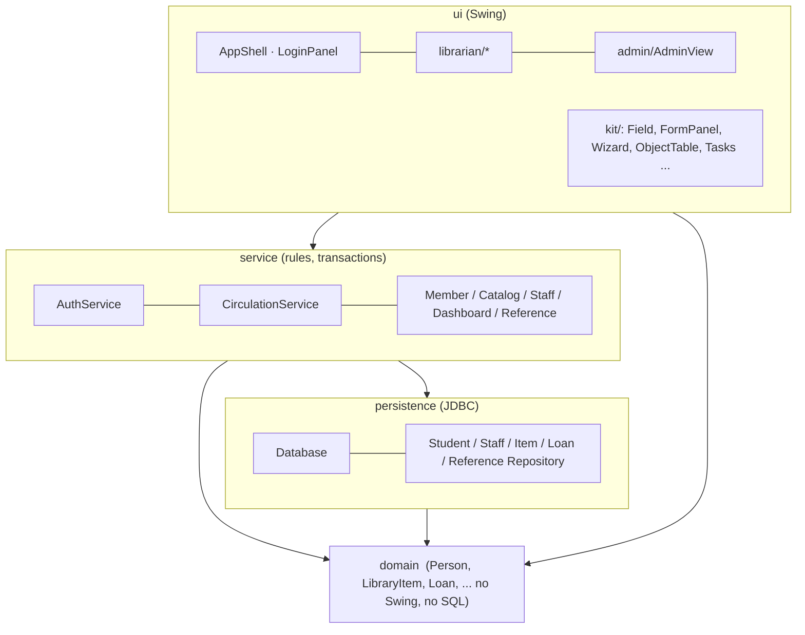
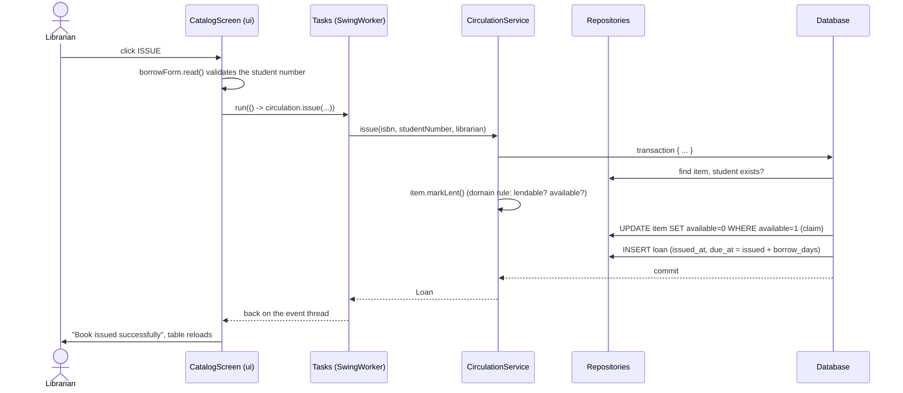

# Architecture

This document explains **how the code is organised and why**, so you can change it with confidence.
For the object model alone see the [generated UML](uml/class-diagram.md); for tables see [DATABASE.md](DATABASE.md).

## The shape: four layers, dependencies point down



| Package | Responsibility | May depend on |
|---|---|---|
| `domain` | The object model and **all validation rules**. Pure Java. | nothing |
| `persistence` | Rows ⇄ objects. Prepared statements. Opens and closes connections. | `domain` |
| `security` | Password hashing and the password policy. | `domain` (exceptions) |
| `service` | Library rules, transactions, "who may do what". | `domain`, `persistence`, `security` |
| `config` | Where settings come from. | nothing |
| `ui` | Screens. Never writes SQL; talks to services only. | `service`, `domain` |

The rule that keeps this maintainable: **a layer never reaches *up***. `domain` cannot import Swing; `persistence` cannot show a dialog.

## Key design decisions

### 1. Validation lives in the domain, once
`Student.setStudentNumber`, the wizard step and the database `CHECK` all enforce "10 digits", but the *Java* rule is written exactly once, as a static validator (`Student.requireStudentNumber`) that the setter, the constructor **and the form field** call. The UI field is built like this:

```text
Field.text("studentNumber", "Student Number", Student::requireStudentNumber)
```
A wrong value is stopped on the step where it was typed, with the domain's own message.

### 2. Inheritance for things that really differ
`LibraryItem` is `abstract sealed ... permits PrintedBook, DigitalBook, OtherMaterial`. The subclasses differ in *behaviour*, not just data:

| | `PrintedBook` | `DigitalBook` | `OtherMaterial` |
|---|---|---|---|
| `isBorrowable()` | true | true | **false** |
| `consumesCopyOnLoan()` | **true** (one copy) | false (unlimited) | false |
| `tableRow()` / `lines()` | publisher, LC class, availability | URL | type, "Reference only" |
| author | required | required | optional |

The UI has one `CatalogScreen` for all three. It calls `item.tableRow()`, `item.lines()`, `item.isBorrowable()` and never tests the concrete type: **polymorphism does the work** (try adding a fourth kind; see below). `Person` ► `Student`, `Staff` shares name validation the same way.

`sealed` has two payoffs: the compiler tells you everywhere a new subclass must be handled (the `switch` in `ItemRepository.insert` has no `default`), and readers can see the whole hierarchy at once.

### 3. One interface for unrelated classes: `Displayable`
`LibraryItem`, `Person` and `Loan` have nothing in common except that a detail card can show them (`title()`, `subtitle()`, `lines()`). `DetailCard` renders any of them, and the wizard's review step is the *same card* showing the object that is about to be saved.

### 4. Single-table inheritance in the database
All catalog kinds share the `item` table with an `item_type` discriminator; `CHECK` constraints force each kind to carry the columns it needs. Simple queries and one primary-key space (an ISBN cannot be registered twice as different kinds). The trade-off is some nullable columns; see [DATABASE.md](DATABASE.md).

### 5. Transactions where two tables must agree
Lending inserts a `loan` row *and* marks the book unavailable; returning does the reverse. `Database.transaction(...)` commits both or rolls both back. Two librarians lending the last copy at once are separated by a conditional update (`UPDATE item SET available = 0 WHERE code = ? AND available = 1`): exactly one gets a row count of 1 (`CirculationIT` runs eight threads at it).

### 5b. Rules are enforced where the data is, not where the button is
`StaffService`'s operations take the acting `Staff` and re-read it from the database ("is this really an unlocked administrator?"); `CirculationService.issue` does the same for the issuing librarian. The UI merely *hides* screens; hiding is not security, because the next developer may call the service from somewhere else. (See the "Known limits" in [SECURITY.md](../SECURITY.md) for what this does and does not protect.)

### 6. Errors have two audiences
* **User-facing** (`UserFacingException`: `ValidationException`, `BusinessRuleException`): the message is written for the librarian and shown as-is.
* **Technical** (`DataAccessException`): logged in full, shown as one generic sentence. SQL text never reaches the screen.

`UiContext.report` is the single place that decides which is which.

### 7. The UI never blocks, and is testable
`Tasks.run(...)` runs database work in a `SwingWorker` and returns to the event thread with the result. Dialogs go through the `Messenger` interface (`SwingMessenger` uses `JOptionPane`; tests use `RecordingMessenger`), so end-to-end tests never hang on a modal dialog. Both are *constructor-injected* through `UiContext`: there are no singletons and no static state, and no DI framework is needed at this size.

### 8. Settings are not code
`AppConfig` reads environment variables, then `lms.properties`, then defaults. Nothing secret is in the repository; the database account has only `SELECT/INSERT/UPDATE/DELETE`.

### 9. Why no ORM, no connection pool?
For learning, JDBC shows what actually happens. A desktop app with a handful of users opens a connection per operation without trouble. `Database` is the single seam: to add HikariCP or Hibernate later, change that class and the repositories only.

## Flow of one request: "borrow a book"



## Threading rules
* Swing components are touched **only** on the event-dispatch thread.
* Anything that talks to the database goes through `Tasks.run`.
* `AuthService.login` is `synchronized` (it keeps the throttle counters); everything else is stateless.

## Extending the system

### Add a new kind of catalog entry (say, `Audiobook`)
1. `domain/Audiobook.java`: `extends LibraryItem`, call `super(...)`, implement the abstract methods. Add it to `permits` in `LibraryItem`.
2. `domain/ItemType`: add `AUDIOBOOK(label, columns)`.
3. Compile. The compiler now points at every `switch` that must handle it: `ItemRepository.insert/map`, `ItemWizards.create`, `CatalogScreen`'s `key/noun/widths`.
4. `db/*/01_schema.sql`: extend `ck_item_type` and `ck_item_shape`.
5. Add a nav item in `LibrarianView` and tests (`DomainModelTest`, `MemberCatalogIT`).

### Add a screen
Implement `Screen` (or extend `MasterDetailScreen<T>` if it is "table + side panel"), register it in `LibrarianView`, give components `setName(...)` so tests can find them.

### Support another database
Add `db/<vendor>/` scripts and the JDBC driver dependency. The SQL in the repositories is portable by design: dates come from Java (`setObject(LocalDateTime)`), no vendor functions, no `LIMIT`/`TOP`. `TestDatabase` and the CI matrix are the places to wire it in.

## Modern Java used on purpose
`record` (value objects: `Address`, `Department`, `Loan`, `Services`) · `sealed` classes/interfaces (`LibraryItem`, `Person`, `LoginResult`, `UserFacingException`) · pattern-matching `switch` with record patterns (`LoginPanel.handle`) · exhaustive `switch` expressions without `default` · text blocks (`LoanRepository`) · `try`-with-resources everywhere · `java.time` (no `Date`/`Calendar`) · `System.Logger` · injectable `Clock` (tests move time forward to create overdue loans).
