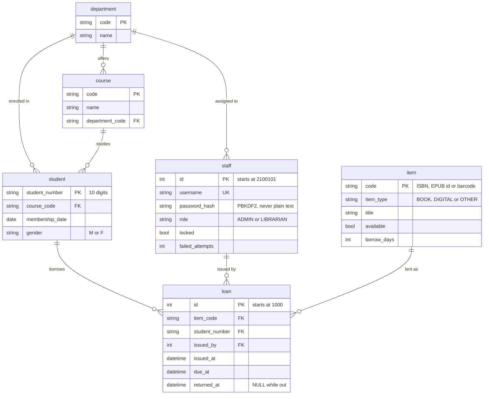

# Database

Two equivalent schemas: [`db/mysql`](../db/mysql) (MySQL 8.0.16+) and [`db/mssql`](../db/mssql) (SQL Server 2019+).
The application code is identical for both; only the JDBC URL differs.

## Scripts

| Script | Run as | Purpose |
|---|---|---|
| `00_create_database` | administrator | Creates the database and a **least-privilege** application user (`SELECT/INSERT/UPDATE/DELETE`, no DDL). Replace `YOUR_STRONG_PASSWORD` first. |
| `01_schema` | administrator | Tables, keys, `CHECK` constraints, indexes. |
| `02_seed` | administrator | Demo data. **Generated**; do not edit by hand. |
| `99_reset` | administrator | **Drops everything.** For starting over. |

## Entity-relationship diagram



## Design notes

* **One `staff` table for both roles.** A `role` column (`ADMIN`/`LIBRARIAN`) replaces the legacy design with a hard-coded administrator and a separate librarian table. That is what makes a single sign-in possible.
* **One `loan` table for the whole lifecycle.** The legacy `ISSUE` + `RETURNED` pair duplicated every column. Now `returned_at IS NULL` means "still out": *Issued* = open, *Returned* = closed, *Missing* = open and `due_at < now`.
* **Single-table inheritance for the catalog.** `item` holds books, e-books and other materials; the `ck_item_shape` constraint states what each kind must contain (a `BOOK` needs a publisher, genre and LC class; `OTHER` is never available; ...). The database refuses a malformed row even if another program writes it.
* **Identifiers are text.** `student_number` and `item.code` are `VARCHAR` (digits only, by `CHECK`), not numbers: a leading zero must not vanish.
* **Referential integrity protects history.** A member or librarian who appears in `loan` cannot be deleted (foreign key). The application checks first and explains why.
* **Dates come from Java.** Services pass `LocalDateTime` values; no SQL uses `NOW()`/`GETDATE()`. This keeps the SQL portable and lets tests move the clock. (Only the *seed script* uses `NOW()` so that demo loans are relative to the day you load it.)

## MySQL ⇄ SQL Server differences (all in the scripts, none in Java)

| Concern | MySQL | SQL Server |
|---|---|---|
| Text type | `VARCHAR` (`utf8mb4`) | `NVARCHAR` (Unicode) |
| Boolean | `BOOLEAN` (`TINYINT(1)`) | `BIT` |
| Timestamp | `DATETIME` | `DATETIME2(0)` |
| Auto-number | `AUTO_INCREMENT = 2100101` | `IDENTITY(2100101, 1)` |
| Regex check | `REGEXP '^[0-9]{10}$'` | `LIKE` / `LEN` patterns |
| Foreign-key indexes | created automatically | created explicitly (`ix_...`) |
| Seed with fixed ids | plain `INSERT` | `SET IDENTITY_INSERT ... ON/OFF` |
| Seed timestamps | `DATE_SUB(NOW(), INTERVAL n SECOND)` | `DATEADD(SECOND, -n, SYSDATETIME())` |

## Seed data

| Table | Rows | Source |
|---|---|---|
| `department`, `course` | 23, 100 | Real: the university's colleges, campuses and programs |
| `item` | 630 (309 books, 188 e-books, 133 other) | 255 real catalog entries from the original project + 375 generated ones with valid ISBN-13 check digits |
| `student` | 600 | **Synthetic** |
| `staff` | 30 (1 admin + 29 librarians, 2 locked) | **Synthetic** |
| `loan` | ~1,030 (about 85 open, about 30 overdue) | **Synthetic**, consistent: a printed book is never out twice, and `item.available` agrees with open loans |

All people are randomly assembled from name pools, with random student numbers, phone numbers and addresses (Data Privacy Act). Regenerate both scripts:

```bash
./mvnw -q compile
java -cp target/classes db/tools/SeedGenerator.java      # Windows: -cp target\classes
```
Output is deterministic (fixed random seed) except for password salts. Change the counts at the top of `SeedGenerator.java`.

## Querying by hand

```sql
-- what the "Missing" screen shows
SELECT l.id, i.title, s.last_name, l.due_at
FROM loan l JOIN item i ON i.code = l.item_code JOIN student s ON s.student_number = l.student_number
WHERE l.returned_at IS NULL AND l.due_at < NOW();          -- SQL Server: SYSDATETIME()
```
