# UML class diagrams

> **Generated from the compiled classes** by `UmlDiagramGenerator` (test sources). Do not edit by hand:
> `UmlDiagramTest` fails when this file no longer matches the code. See the header of the generator for the
> regeneration command.

## Domain model

Inheritance (`Person` and `LibraryItem` are abstract and sealed), the `Displayable` interface shared by
unrelated classes, and the value types they use.

```mermaid
classDiagram
    direction TB
    class Displayable {
        <<interface>>
        +lines() List~String~
        +subtitle() String
        +title() String
    }
    class Person {
        <<abstract>>
        +int INITIAL_MAX$
        +int NAME_MAX$
        -String firstName
        -String lastName
        -String middleInitial
        #Person(String firstName, String middleInitial, String lastName)
        +formatName(String first, String middleInitial, String last)$ String
        +fullName() String
        +getFirstName() String
        +getLastName() String
        +getMiddleInitial() String
        +identifier()* String
        +listName() String
        +optionalInitial(String raw)$ String
        +requireName(String raw, String label)$ String
        +roleLabel()* String
        +setFirstName(String firstName) void
        +setLastName(String lastName) void
        +setMiddleInitial(String middleInitial) void
        +title() String
    }
    class Student {
        -Address address
        -String contactNumber
        -String courseCode
        -String departmentCode
        -Gender gender
        -LocalDate membershipDate
        -String section
        -String studentNumber
        +Student(String studentNumber, String firstName, String middleInitial, String lastName, String departmentCode, String courseCode, String section, Gender gender, String contactNumber, Address address, LocalDate membershipDate)
        +Student(String studentNumber, String firstName, String middleInitial, String lastName, String departmentCode, String courseCode, String section, Gender gender, String contactNumber, Address address)
        +getAddress() Address
        +getContactNumber() String
        +getCourseCode() String
        +getDepartmentCode() String
        +getGender() Gender
        +getMembershipDate() LocalDate
        +getSection() String
        +getStudentNumber() String
        +identifier() String
        +lines() List~String~
        +requireContactNumber(String raw)$ String
        +requireSection(String raw)$ String
        +requireStudentNumber(String raw)$ String
        +roleLabel() String
        +setAddress(Address address) void
        +setContactNumber(String contactNumber) void
        +setCourseCode(String courseCode) void
        +setDepartmentCode(String departmentCode) void
        +setGender(Gender gender) void
        +setMembershipDate(LocalDate membershipDate) void
        +setSection(String section) void
        +setStudentNumber(String studentNumber) void
        +subtitle() String
    }
    class Staff {
        +int MAX_FAILED_ATTEMPTS$
        +List~String~ POSITIONS$
        -String departmentCode
        -int failedAttempts
        -int id
        -boolean locked
        -String passwordHash
        -String position
        -Role role
        -String username
        +Staff(int id, String firstName, String middleInitial, String lastName, String position, String departmentCode, String username, String passwordHash, Role role, boolean locked, int failedAttempts)
        +Staff(String firstName, String middleInitial, String lastName, String position, String departmentCode, String username, String passwordHash, Role role)
        +getDepartmentCode() String
        +getFailedAttempts() int
        +getId() int
        +getPasswordHash() String
        +getPosition() String
        +getRole() Role
        +getUsername() String
        +identifier() String
        +isLocked() boolean
        +lines() List~String~
        +recordFailedLogin() boolean
        +recordSuccessfulLogin() void
        +requireUsername(String raw)$ String
        +roleLabel() String
        +setDepartmentCode(String departmentCode) void
        +setPasswordHash(String passwordHash) void
        +setPosition(String position) void
        +setUsername(String username) void
        +subtitle() String
        +unlock() void
    }
    class Role {
        <<enumeration>>
        ADMIN
        LIBRARIAN
        +canBeLocked() boolean
        +label() String
    }
    class Gender {
        <<enumeration>>
        Male
        Female
        +code() String
        +fromCode(String code)$ Gender
        +label() String
        +toString() String
    }
    class Address {
        <<record>>
        -String barangay
        -String houseNo
        -String municipality
        -String province
        -String street
        +areaLine() String
        +barangay() String
        +houseNo() String
        +municipality() String
        +province() String
        +requireBarangay(String raw)$ String
        +requireHouseNo(String raw)$ String
        +requireMunicipality(String raw)$ String
        +requireProvince(String raw)$ String
        +requireStreet(String raw)$ String
        +street() String
        +streetLine() String
    }
    class LibraryItem {
        <<abstract>>
        +int CODE_MAX$
        +int MAX_BORROW_DAYS$
        -String author
        -boolean authorRequired
        -boolean available
        -int borrowDays
        -String code
        -String codeLabel
        -int minBorrowDays
        -int pages
        -int publicationYear
        -String title
        #LibraryItem(String codeLabel, String code, String title, String author, boolean authorRequired, int publicationYear, int pages, int minBorrowDays, int borrowDays, boolean available)
        #authorOrNotAvailable() String
        #borrowText()* String
        +canBeBorrowedNow() boolean
        +consumesCopyOnLoan()* boolean
        +dueDateFrom(LocalDateTime issuedAt) LocalDateTime
        +getAuthor() String
        +getBorrowDays() int
        +getCode() String
        +getCodeLabel() String
        +getPages() int
        +getPublicationYear() int
        +getTitle() String
        +isAvailable() boolean
        +isBorrowable()* boolean
        +markLent() void
        +markReturned() void
        +requireAuthor(String raw, boolean required)$ String
        +requireBorrowDays(int days, int min)$ int
        +requireCode(String raw, String label)$ String
        +requirePages(int pages)$ int
        +requireTitle(String raw)$ String
        +setAuthor(String author) void
        +setBorrowDays(int borrowDays) void
        +setCode(String code) void
        +setPages(int pages) void
        +setPublicationYear(int publicationYear) void
        +setTitle(String title) void
        +subtitle() String
        +tableRow()* List~String~
        +title() String
        +type()* ItemType
    }
    class PrintedBook {
        -String genre
        -String lcClass
        -String publisher
        +PrintedBook(String isbn, String title, String author, String publisher, int publicationYear, String genre, String lcClass, int pages, int borrowDays, boolean available)
        +PrintedBook(String isbn, String title, String author, String publisher, int publicationYear, String genre, String lcClass, int pages, int borrowDays)
        #borrowText() String
        +consumesCopyOnLoan() boolean
        +getGenre() String
        +getLcClass() String
        +getPublisher() String
        +isBorrowable() boolean
        +lines() List~String~
        +requireGenre(String raw)$ String
        +requireLcClass(String raw)$ String
        +requirePublisher(String raw)$ String
        +setGenre(String genre) void
        +setLcClass(String lcClass) void
        +setPublisher(String publisher) void
        +tableRow() List~String~
        +type() ItemType
    }
    class DigitalBook {
        -String genre
        -String url
        +DigitalBook(String epubId, String title, String author, int publicationYear, String genre, int pages, int borrowDays, String url)
        #borrowText() String
        +consumesCopyOnLoan() boolean
        +getGenre() String
        +getUrl() String
        +isBorrowable() boolean
        +lines() List~String~
        +requireUrl(String raw)$ String
        +setGenre(String genre) void
        +setUrl(String url) void
        +tableRow() List~String~
        +type() ItemType
    }
    class OtherMaterial {
        -MaterialType materialType
        -String publisher
        +OtherMaterial(String barcode, String title, String author, String publisher, int publicationYear, int pages, MaterialType materialType)
        #borrowText() String
        +consumesCopyOnLoan() boolean
        +getMaterialType() MaterialType
        +getPublisher() String
        +isBorrowable() boolean
        +lines() List~String~
        +optionalPublisher(String raw)$ String
        +setMaterialType(MaterialType materialType) void
        +setPublisher(String publisher) void
        +tableRow() List~String~
        +type() ItemType
    }
    class ItemType {
        <<enumeration>>
        BOOK
        DIGITAL
        OTHER
        +columns() List~String~
        +label() String
    }
    class MaterialType {
        <<enumeration>>
        Journals
        Magazine
        Thesis
        +label() String
        +toString() String
    }
    class Loan {
        <<record>>
        -String courseCode
        -LocalDateTime dueAt
        -int id
        -LocalDateTime issuedAt
        -int issuedById
        -String issuedByName
        -String itemCode
        -String itemTitle
        -LocalDateTime returnedAt
        -String studentName
        -String studentNumber
        +courseCode() String
        +dueAt() LocalDateTime
        +dueText() String
        +id() int
        +isOverdue(LocalDateTime now) boolean
        +isReturned() boolean
        +issuedAt() LocalDateTime
        +issuedById() int
        +issuedByName() String
        +issuedText() String
        +itemCode() String
        +itemTitle() String
        +lines() List~String~
        +returnedAt() LocalDateTime
        +returnedText() String
        +studentName() String
        +studentNumber() String
        +subtitle() String
        +title() String
    }
    class Department {
        <<record>>
        -String code
        -String name
        +code() String
        +name() String
    }
    class Course {
        <<record>>
        -String code
        -String departmentCode
        -String name
        +code() String
        +departmentCode() String
        +name() String
    }
    Displayable <|.. Person
    Person <|-- Student
    Student --> Address : address
    Student --> Gender : gender
    Person <|-- Staff
    Staff --> Role : role
    Displayable <|.. LibraryItem
    LibraryItem <|-- PrintedBook
    LibraryItem <|-- DigitalBook
    LibraryItem <|-- OtherMaterial
    OtherMaterial --> MaterialType : materialType
    Displayable <|.. Loan
```

## Services, repositories and infrastructure

```mermaid
classDiagram
    direction TB
    class AuthService {
        +Duration FAILURE_WINDOW$
        +int THROTTLE_AFTER_FAILURES$
        +Duration THROTTLE_DURATION$
        -Instant blockedUntil
        -Clock clock
        -int consecutiveFailures
        -Database database
        -String decoyHash
        -PasswordHasher hasher
        -Instant lastFailure
        -StaffRepository staffRepository
        +AuthService(Database database, StaffRepository staffRepository, PasswordHasher hasher, Clock clock)
        +login(String rawUsername, char[] password) LoginResult
    }
    class StaffService {
        -Database database
        -PasswordHasher hasher
        -LoanRepository loanRepository
        -StaffRepository staffRepository
        +StaffService(Database database, StaffRepository staffRepository, LoanRepository loanRepository, PasswordHasher hasher)
        +addLibrarian(Staff actor, String firstName, String middleInitial, String lastName, String position, String departmentCode, String username, char[] password) int
        +librarians() List~Staff~
        +remove(Staff actor, int id) void
        +unlock(Staff actor, int id) void
        +updateLibrarian(Staff actor, int id, String username, char[] newPassword, String departmentCode, String position) void
    }
    class MemberService {
        -Database database
        -LoanRepository loanRepository
        -StudentRepository studentRepository
        +MemberService(Database database, StudentRepository studentRepository, LoanRepository loanRepository)
        +count() int
        +ensureNumberIsFree(String studentNumber) void
        +members() List~Student~
        +register(Student student) void
        +remove(String studentNumber) void
    }
    class CatalogService {
        -Database database
        -ItemRepository itemRepository
        +CatalogService(Database database, ItemRepository itemRepository)
        +add(LibraryItem item) void
        +count(ItemType type) int
        +ensureCodeIsFree(String code, String label) void
        +find(String code) Optional~LibraryItem~
        +items(ItemType type) List~LibraryItem~
    }
    class CirculationService {
        -Clock clock
        -Database database
        -ItemRepository itemRepository
        -LoanRepository loanRepository
        -StaffRepository staffRepository
        -StudentRepository studentRepository
        +CirculationService(Database database, ItemRepository itemRepository, StudentRepository studentRepository, LoanRepository loanRepository, StaffRepository staffRepository, Clock clock)
        +giveBack(int loanId) Loan
        +issue(String itemCode, String studentNumber, Staff issuedBy) Loan
        +loans(LoanView view) List~Loan~
    }
    class DashboardService {
        -Clock clock
        -Database database
        -ItemRepository itemRepository
        -LoanRepository loanRepository
        -StudentRepository studentRepository
        +DashboardService(Database database, ItemRepository itemRepository, StudentRepository studentRepository, LoanRepository loanRepository, Clock clock)
        +summary() LibrarySummary
    }
    class ReferenceService {
        -List~Course~ courses
        -Database database
        -List~Department~ departments
        -ReferenceRepository referenceRepository
        +ReferenceService(Database database, ReferenceRepository referenceRepository)
        +coursesOf(String departmentCode) List~Course~
        +departments() List~Department~
    }
    class StaffRepository {
        +StaffRepository()
        +delete(Connection connection, int id) int
        +findById(Connection connection, int id) Optional~Staff~
        +findByRole(Connection connection, Role role) List~Staff~
        +findByUsername(Connection connection, String username) Optional~Staff~
        +insert(Connection connection, Staff staff) int
        +updateAccount(Connection connection, Staff staff) int
        +updateLoginState(Connection connection, Staff staff) int
        +usernameTaken(Connection connection, String username, int exceptId) boolean
    }
    class StudentRepository {
        +StudentRepository()
        +count(Connection connection) int
        +delete(Connection connection, String studentNumber) int
        +exists(Connection connection, String studentNumber) boolean
        +find(Connection connection, String studentNumber) Optional~Student~
        +findAll(Connection connection) List~Student~
        +insert(Connection connection, Student student) void
    }
    class ItemRepository {
        +ItemRepository()
        +count(Connection connection, ItemType type) int
        +exists(Connection connection, String code) boolean
        +find(Connection connection, String code) Optional~LibraryItem~
        +findAll(Connection connection, ItemType type) List~LibraryItem~
        +insert(Connection connection, LibraryItem item) void
        +setAvailable(Connection connection, String code, boolean available) int
        +tryClaim(Connection connection, String code) int
    }
    class LoanRepository {
        +LoanRepository()
        +countForStudent(Connection connection, String studentNumber) int
        +countIssuedBy(Connection connection, int staffId) int
        +countOpen(Connection connection) int
        +countOverdue(Connection connection, LocalDateTime now) int
        +countReturned(Connection connection) int
        +findById(Connection connection, int id) Optional~Loan~
        +findOpen(Connection connection) List~Loan~
        +findOverdue(Connection connection, LocalDateTime now) List~Loan~
        +findReturned(Connection connection) List~Loan~
        +insert(Connection connection, String itemCode, String studentNumber, int issuedBy, LocalDateTime issuedAt, LocalDateTime dueAt) int
        +markReturned(Connection connection, int id, LocalDateTime returnedAt) int
    }
    class Database {
        -AppConfig config
        +Database(AppConfig config)
        +config() AppConfig
        +query(SqlFunction~T~ work) T
        +transaction(SqlFunction~T~ work) T
        +verifyConnection() void
    }
    class PasswordHasher {
        +int DEFAULT_ITERATIONS$
        -int iterations
        -SecureRandom random
        +PasswordHasher(int iterations)
        +PasswordHasher()
        +hash(char[] password) String
        +verify(char[] password, String stored) boolean
    }
    AuthService --> Database : database
    AuthService --> PasswordHasher : hasher
    AuthService --> StaffRepository : staffRepository
    StaffService --> Database : database
    StaffService --> PasswordHasher : hasher
    StaffService --> LoanRepository : loanRepository
    StaffService --> StaffRepository : staffRepository
    MemberService --> Database : database
    MemberService --> LoanRepository : loanRepository
    MemberService --> StudentRepository : studentRepository
    CatalogService --> Database : database
    CatalogService --> ItemRepository : itemRepository
    CirculationService --> Database : database
    CirculationService --> ItemRepository : itemRepository
    CirculationService --> LoanRepository : loanRepository
    CirculationService --> StaffRepository : staffRepository
    CirculationService --> StudentRepository : studentRepository
    DashboardService --> Database : database
    DashboardService --> ItemRepository : itemRepository
    DashboardService --> LoanRepository : loanRepository
    DashboardService --> StudentRepository : studentRepository
    ReferenceService --> Database : database
```

